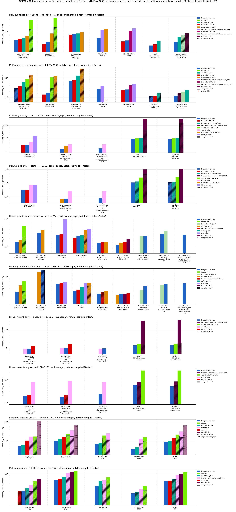

# finegrained-kernels

Triton GEMM + MoE kernels for fine-grained quantization — block/tensor/row-wise FP8, MXFP8, MXFP4,
two-level NVFP4, and INT2/INT4/INT8 weights, with fused gate|up GLU epilogues, fused intermediate requantization, and
expert routing — developed as part of the HuggingFace Transformers FP8 + MoE optimization effort.

All tuning and validation is on NVIDIA Blackwell (SM100 / B200), whose tcgen05 scaled-MMA the MX
paths target; Hopper (SM90) runs the same Triton paths, and ROCm / XPU backends are built but
unvalidated.

## Benchmarks



Real model shapes on an NVIDIA B200, against upstream `finegrained-fp8`, DeepGEMM, vLLM's fused
MoE, FlashInfer's TRT-LLM routed-MoE kernels, transformers `grouped_mm`/`batched_mm`, SonicMoE,
OpenAI `triton_kernels`, and `torch.scaled_grouped_mm`.
Decode is cudagraph-captured, prefill eager; a red ✕ marks a configuration that raised. Every
baseline's output is parity-checked against the finegrained-kernels anchor in the same run. See
[`bench/README.md`](bench/README.md) to reproduce.

## Public API

Three GEMM dispatchers, the two fused MoE forwards, and the load-time helpers:

```python
from finegrained_kernels import (
    matmul_2d, matmul_batched, matmul_grouped,           # GEMM dispatchers
    moe_fused_batched, moe_fused_grouped,                # fused MoE forwards
    swizzle_mx_scales, unswizzle_mx_scales,              # weight scales <-> tcgen05 layout, at load
    mxfp8_act_quant, mxfp4_act_quant, nvfp4_act_quant,   # row-wise group quantizers (weights at load, activations offline)
    get_supported_act_fns,                               # GLU activations the fused epilogue implements
)
```

The unfused two-GEMM references (`moe.moe_unfused_*`), the cuBLAS baseline (`moe.moe_torch_grouped`),
`scheduling.compute_grouped_scheduling` and the block/tensor fp8 and two-level NVFP4 quantizers stay
importable from their modules.

### GEMM dispatchers

Every op takes the same operand spec and routes to the right kernel **from the weight dtype and
scale shape** — the format falls out of the data, so it can never disagree with a parameter:

```python
matmul_2d(A, B, As=None, Bs=None, *, activation_format=None, gate=False, act_fn="silu",
          swiglu_alpha=None, swiglu_limit=None, quantize_output=False, output_dtype=None,
          a_global_scale=None, b_global_scale=None, output_global_scale=None)
matmul_batched(A, B, As, Bs, *, expert_ids, gather_idx=None, scatter_idx=None, ...same keywords...)
matmul_grouped(A, B, As, Bs, *, expert_start, gather_idx=None, scatter_idx=None, ...same keywords...)
```

- `A` `(M, K)` activations — raw bf16/fp16/fp32 (the op quantizes inline or offline as the format
  needs) or pre-quantized with `As`.
- `B` weights — `(N, K)` for `matmul_2d`, `(E, N, K)` for the routed ops. `Bs` selects the format
  (see the format matrix below).
- `activation_format` is the activations' quantization, in the same vocabulary as transformers'
  `FineGrainedConfig`: `None` (default) = the weights' own format, `"bf16"` = weight-only (W4A16 /
  W8A16), or an explicit `"fp8"` / `"int8"` / `"mxfp8"` / `"mxfp4"` / `"nvfp4"` (`"mxfp8"` on MXFP4 weights =
  the W4A8 chain). The weight format is never named — it is read off `B`/`Bs`.
- `gate=True, act_fn="silu", swiglu_alpha=..., swiglu_limit=...` fuses the gate|up GLU: `B` holds
  the interleaved `(2N, K)` gate|up rows (see the layout contract below) and the op returns the
  activated `(M, N)` intermediate; `quantize_output=True` stores it in `activation_format` for the
  next op (a `(C, Cs)` tuple is returned instead of a dense tensor). `act_fn=None` skips the
  activation and returns the raw `(M, 2N)` interleaved gate|up output, for an activation applied
  by the caller.
- `a_global_scale` / `b_global_scale` / `output_global_scale` are the NVFP4 second level, fp32
  globals folded onto the accumulator: one value for the tensor, or `(E,)` per expert. A
  per-expert `a_global_scale` needs rows that belong to one expert each: `matmul_batched` reads
  the row's expert id, and `matmul_grouped` requires expert-sorted rows (`gather_idx=None`). A
  gate|up stack whose halves a checkpoint calibrated separately carries one global per half; the
  loader merges those into one per expert (the up half's folds into the down projection's global,
  SwiGLU being linear in it) rather than the ops taking a second layout.
- Weight-only FP8 (`activation_format="bf16"`) also accepts coarse block scales and one scale
  per tensor/expert, with unquantized activations. Coarse FP8 entrypoints are inference-only.
- Routing: `matmul_batched` reads one expert id per row (`expert_ids`, EP sentinels
  `>= num_experts` skipped); `matmul_grouped` takes the launch maps from
  `compute_grouped_scheduling(expert_ids, num_experts, top_k)` — no pre-sorted input required.

### Weight format matrix

| format | `B` dtype | `Bs` | second level |
| --- | --- | --- | --- |
| full precision | bf16 / fp16 | `None` | — |
| block FP8 (128×128) | `float8_e4m3fn` | fp32 or UE8M0 `(⌈N/128⌉, K/128)` (the block is derived from the K dim, so K must divide) | — |
| tensor FP8 | `float8_e4m3fn` | one scalar | — |
| row-wise FP8 | `float8_e4m3fn` | fp32 `(N, 1)`, one per output row | — |
| MXFP8 | `float8_e4m3fn` | UE8M0 `(N, K/32)` (raw `uint8` accepted) | — |
| MXFP4 | packed E2M1 (`int8`, 2/byte) | UE8M0 `(N, K/32)` | — |
| NVFP4 | packed E2M1 (`int8`, 2/byte) | E4M3 `(N, K/16)` | fp32 global(s) |
| INT2 / INT4 / INT8 | interleaved `uint32` words (`32 / bits` values/word) | bf16 / fp16 / fp32 `(N, K/group)` | — |

Integer weights use raw bf16/fp16 activations and optional `b_zero` values shaped like `Bs`
(default: `2 ** (bits - 1)`). Dequantization rounds `(q - zero) * scale` in the scale dtype,
then casts each weight to the activation dtype before multiplication, including per-channel
scales (`group=K`, one scale per output row). Group widths and K tiles must divide one another;
the K dimension must contain whole groups. Use `interleave_int_words` for naturally packed
words, `repack_gptq_int4` for GPTQ v1/v2 (including act-order), or `repack_awq_int4` for AWQ
GEMM checkpoints. Natural `int32` checkpoint words are rejected to prevent confusing the two layouts.
For ModelOpt's signed exports, `repack_modelopt_int4` reads `uint8` `(N/2, K)` with two
output channels per byte, and `repack_modelopt_int8` reads signed `int8` `(N, K)` with one
scale per output channel. Both also accept expert stacks and return `(weight, scale, None)`
for these same integer GEMMs. Pass an exported AWQ `pre_quant_scale` as `a_pre_quant_scale`
to an integer GEMM, or fuse it upstream. It multiplies the raw input columns before any
act-order permutation, rounded in the activation dtype. Dense scales are contiguous `(K,)`;
routed scales are shared `(K,)` / `(1, K)` or per expert `(E, K)`, on the activation's device
and in its dtype. MoE forwards accept `gate_up_proj_pre_quant_scale` and
`down_proj_pre_quant_scale`, including a separate down input vector per expert. A fused
gate/up stack uses a common input transform for both halves, as after ModelOpt's resmoothing.
For ModelOpt `W4A8_AWQ`, use `activation_format="fp8"`, `As=input_scale`, and
`b_global_scale=weight_scale_2` with the repacked symmetric INT4 weight and its original
group scales. The kernel reconstructs the weight, rounds it to E4M3 against `weight_scale_2`,
and restores both calibrated factors before FP32 bias/GLU. `activation_format="int8"` with
`As=input_scale` selects ModelOpt INT8 SmoothQuant on symmetric per-channel INT8 weights:
the dot accumulates in INT32, then applies per-channel weight scales and input scale in FP32.
Both recipes take raw activations and keep the intermediate unquantized between projections;
the down's own calibration and optional input transform apply before its quantization.

ModelOpt `W4A8_MXFP4_FP8` and `W4A8_NVFP4_FP8` also use `activation_format="fp8"` and
`As=input_scale`. Both use group-32 FP4 weights; NVFP4's E4M3 block scales and separate
`weight_scale_2` differ from group-16 NVFP4 W4A4. Ordinary FP8 activations keep one calibrated
scale per tensor/expert; they are not re-quantized per block as MXFP8. The MX loops consume
unit activation group scales; affine NVFP4 prefill instead reuses the weight-upcast GEMM,
storing FP8-rounded inputs exactly in BF16. Both restore calibration in the FP32 epilogue. Input
`pre_quant_scale` also supports MX/FP4 activation-quantized paths, including NVFP4 AWQ.

ModelOpt `NVFP4_SVD` (SVDQuant) is supported by dense `matmul_2d`: pass the BF16
`svdquant_lora_a` `(rank, K)`, `svdquant_lora_b` `(N, rank)` and input `pre_quant_scale`:

```python
out = matmul_2d(
    x, weight.view(torch.int8), Bs=weight_scale,
    a_global_scale=input_scale, b_global_scale=weight_scale_2,
    a_pre_quant_scale=pre_quant_scale,
    svdquant_lora_a=lora_a, svdquant_lora_b=lora_b,
    simulate_unfused=True,
)
```

Smoothing, NVFP4 activation quantization and the BF16 low-rank down projection normally share one pass.
Large rank-32 prefill on SM10x quantizes separately from the down projection; both smooth the input
without materializing an extra activation buffer. The up projection is fused into the GEMM epilogue
before GLU/requant. All dot products accumulate in FP32. `simulate_unfused=True` matches the
BF16 materialization points in ModelOpt's two linear branches and their addition; the default
retains FP32 for the final sum.
Factors use the checkpoint's orientation without pre-folding smoothing or global scales into them.
Weight scales may be affine or pre-swizzled at load time. Gate/up weights and their up-factor rows
must use the usual interleaved order; independent gate/up down factors can be concatenated with
matching zero-padded up factors. Fused gate/up also requires shared smoothing and global scales.
This supports dense BF16 inference with ranks divisible by 32 and K divisible by 64;
routed SVDQuant MoE and Nunchaku's INT4/packed checkpoint layouts are not implemented.
`python bench/bench_moe.py SVDQuant` compares the complete linear on Gemma-4-31B up/down shapes
against FlashInfer, including smoothing, activation quantization and the correction projections.

`repack_ggml_int(payload, "Q4_0" | "Q8_0")` reads canonical little-endian uint8 GGML blocks
`(..., N, K/32, 18 | 34)` and returns the same integer operand tuple with FP32 group scales.
Q8_0 is also a ModelOpt GGML recipe; Q4_0 follows upstream GGML. A GGUF loader supplies the
payload and its logical shape; this helper does not parse containers. IQ codebooks, Q4_1
affine minima, and Q5 formats are unsupported.
GPTQ act-order repacking also returns `b_perm` when K reordering is required.
Fused integer MoE blocks require matching widths, group recipes, and zero-point presence across
gate/up and down. Both projections may use per-channel scales despite their different K dimensions;
scale dtypes and calibrated values may differ between projections.

### Gate|up layout contract

A fused gate|up weight must already be in the layout the kernels read; preparing it is the
loader's job (transformers does it with its conversion ops):

- Rows are **interleaved**, `[gate_0, up_0, gate_1, up_1, ...]`. A stacked `[gate; up]` weight is
  not supported and returns wrong results without an error.
- With 128×128 block FP8, **no scale block may mix gate and up rows**: each projection keeps its
  own scale grid, and the scale rows are interleaved like the weight rows (`[gate block 0, up
  block 0, gate block 1, ...]`). Separate `gate_proj` / `up_proj` checkpoint tensors satisfy this,
  and so does a stacked `[gate; up]` matrix quantized as one when `N` is a multiple of 128 (block
  quantization is local, so the values match). A checkpoint quantized *after* interleaving, or a
  stacked one with `N` not a multiple of 128, has blocks that mix both. Moving rows cannot fix that
  (a 128-row block of one projection would need two scales), so the loader has to requantize those
  blocks; with power-of-two (UE8M0) scales that rescale is exact unless a value leaves the E4M3
  range.
- Per-row scales (MXFP8, MXFP4, NVFP4) and tensor-wide scales have no such ordering question.
  The NVFP4 per-expert globals of gate and up are merged into one per expert, as described above.

Routed ops carry the expert dim in front (`(E, ...)` weights and scales). MX scales may instead be
passed **pre-swizzled** — the 5D output of `swizzle_mx_scales` — which is the deployment contract:

```python
Bs5d = swizzle_mx_scales(Bs)                 # (N, K/g) or (E, N, K/g) -> the tcgen05 layout
gate_up_s = swizzle_mx_scales(gate_up_s, gate=True)   # stacked (E, 2I, H/g) gate|up slabs
```

Swizzle once at model load; the ops read the SWIZZLE_32_4_4 descriptor fast path directly (plain
row-major scales work everywhere but gather per group, capping the scaled dot below peak). A
pre-swizzled gate_up scale is ONE artifact — gate-interleaved (``gate=True``), returned 6-D so the
shape carries the layout — and every path consumes it directly: the fused kernels read a tile's
gate + up block pair off the descriptor, and a plain (unfused) GEMM remaps its block index
in-kernel. No de-interleaving, no per-path copies. One exception: the weight-only ops
(`activation_format="bf16"`, W4A16/W8A16) read affine scales only — keep the row-major scale around if that
path must run.

### MoE forwards

```python
out = moe_fused_grouped(          # prefill; moe_fused_batched is the decode sibling
    hidden_states,                # (T, H)
    top_k_index, top_k_weights,   # (T, K) routing (EP sentinels >= num_experts skipped)
    gate_up_proj,                 # (E, 2I, H)
    down_proj,                    # (E, H, I)
    gate_up_proj_scale_inv, down_proj_scale_inv,
    gate_up_proj_weight_global_scale=None,    # NVFP4 weight second level, per expert
    down_proj_weight_global_scale=None,
    gate_up_proj_input_global_scale=None,     # the checkpoint's calibrated activation input_scale
    down_proj_input_global_scale=None,
    act_fn="silu", swiglu_alpha=None, swiglu_limit=None,
    post_expert_norm=None,        # per-expert output norm: a get_supported_norms() name, or a callable
    post_expert_norm_weight=None, post_expert_norm_eps=1e-6,
    activation_format=None,       # activation quant for the whole block; None = the weights' format, "bf16" = bf16 acts
)
```

The fused forwards run gate_up + GLU + intermediate requant + down + routing-weighted top-k reduce
in two GEMM launches; `moe_unfused_*` are the two-GEMM + host-GLU references (bit-comparable via
`simulate_unfused=True`), and `moe_torch_grouped` is the `torch.scaled_grouped_mm` (cuBLAS)
baseline. `activation_format=None` follows the weight format; `"mxfp8"` on MXFP4 weights gives the
W4A8 chain; `"bf16"` keeps activations bf16 (weight-only W4A16/W8A16). For calibrated NVFP4 checkpoints the
per-projection `input_scale` rides as `*_input_global_scale`: the gate_up quantizes hidden against
its own, requants the intermediate against the down's, and the down consumes it — leave them `None`
for dynamic quant. The gate_up's is one value (its rows are the hidden states, quantized once
before routing); the down's may be per expert, since its rows are.

`post_expert_norm` covers models that norm the down output before the routing weights. It runs on
the routed rows — one row per expert application, where such a norm is defined. A
`get_supported_norms()` name (`"rms_norm"`, `"centered_rms_norm"` scaling by `1 + weight`, or
`"input_scaled_rms_norm"` scaling before normalizing) plus `post_expert_norm_weight` is FUSED: one
pass computes each row's `rsqrt` and the reduce the chain already runs applies it with the column
factor, so the normalized rows are never materialized. Anything else is a host callable applied to
the rows. `rms_norm_rows` exposes the standalone kernel.

### Load-time quantization helpers

`nvfp4_quantize_two_level(weight)` returns `(packed_e2m1, e4m3_block_scales, fp32_global)` — the
canonical two-level NVFP4 weight quant (`global = amax / (6·448)`). The `*_act_quant` helpers are
the offline activation quants the ops use internally, exposed for pre-quantized (`As`) pipelines;
`fp8_act_quant_block_dynamic` / `fp8_act_quant_tensor_wide` are their block-FP8 siblings;
`fp8_act_quant_tensor_wide(x, K, amax_upper_bound=...)` is the per-token quant of the tensor-wide and
row-wise formats, the optional bound capping each row's amax.

## Optimization coverage

Which optimizations each kernel can use, grouped by what they improve. Rows are the kernels per family (the recipes they serve are in the format matrix above); a cell is what the kernel's tuning grid, constexprs and pruners allow. Where a cell is 🟠, the fencing pruner's docstring says where and why.

🟢 available (a tuner axis or config; 🟢* always on) · 🟠 fenced or partial: pruned in some regime · 🔴 not implemented where it would plausibly apply · ⚪ not applicable (⚪† deliberately absent, measured not to win)

#### Scheduling and launch

How work is spread over the GPU and how launches overlap.

| Family | Kernel | warp spec. | persistent | small-tile grid | tile order | packed schedule | PDL |
| --- | --- | --- | --- | --- | --- | --- | --- |
| 2D | block FP8 (dynamic act) | 🟠 | ⚪† | ⚪ | 🟢* | ⚪ | 🟢* |
| 2D | block FP8 (static act) | 🟠 | ⚪† | ⚪ | 🟢* | ⚪ | 🔴 |
| 2D | tensor / row-wise FP8 | 🟠 | ⚪† | ⚪ | 🟢* | ⚪ | 🟢* |
| 2D | MXFP8 / MXFP4 / NVFP4 | 🟢 | 🟠 | ⚪ | 🟢* | ⚪ | 🟢* |
| 2D | MX weight-only (W4A16 / W8A16) | 🟢 | ⚪† | ⚪ | 🟢* | ⚪ | 🔴 |
| 2D | FP8 weight-only | 🟢 | ⚪† | ⚪ | 🟢* | ⚪ | 🔴 |
| 2D | INT2/4/8 (GPTQ, AWQ, SmoothQuant) | 🟠 | ⚪† | ⚪ | 🟢* | ⚪ | 🔴 |
| 2D | BF16 / FP16 | 🟢 | ⚪† | ⚪ | 🟢* | ⚪ | 🔴 |
| batched | block FP8 (dynamic act) | ⚪† | ⚪ | ⚪ | ⚪ | ⚪ | 🟢* |
| batched | block FP8 (static act) | ⚪† | ⚪ | ⚪ | ⚪ | ⚪ | 🟢* |
| batched | tensor / row-wise FP8 | ⚪† | ⚪ | ⚪ | ⚪ | ⚪ | 🟢* |
| batched | MXFP8 / MXFP4 / NVFP4 | ⚪† | ⚪ | ⚪ | ⚪ | ⚪ | 🟢* |
| batched | MX weight-only (W4A16 / W8A16) | ⚪† | ⚪ | ⚪ | ⚪ | ⚪ | 🟢* |
| batched | FP8 weight-only | ⚪† | ⚪ | ⚪ | ⚪ | ⚪ | 🟢* |
| batched | INT2/4/8 (GPTQ, AWQ, SmoothQuant) | ⚪† | ⚪ | ⚪ | ⚪ | ⚪ | 🟢* |
| batched | BF16 / FP16 | ⚪† | ⚪ | ⚪ | ⚪ | ⚪ | 🟢* |
| grouped | block FP8 (dynamic act) | 🟠 | 🟢* | 🟢* | ⚪† | 🟠 | ⚪ |
| grouped | block FP8 (static act) | 🟠 | 🟢* | 🟢* | ⚪† | 🟠 | ⚪ |
| grouped | tensor / row-wise FP8 | 🟠 | 🟢* | 🟢* | 🟢* | 🟠 | ⚪ |
| grouped | MXFP8 / MXFP4 / NVFP4 | 🟠 | 🟢* | 🟢* | ⚪† | 🟠 | ⚪ |
| grouped | MX weight-only (W4A16 / W8A16) | 🟠 | 🟢* | 🟢* | ⚪† | 🟠 | ⚪ |
| grouped | FP8 weight-only | 🟠 | 🟢* | 🟢* | ⚪† | 🟠 | ⚪ |
| grouped | INT2/4/8 (GPTQ, AWQ, SmoothQuant) | 🟠 | 🟢* | 🟢 | ⚪† | 🟠 | ⚪ |
| grouped | BF16 / FP16 | 🟢 | 🟢* | 🟢* | ⚪† | 🟠 | ⚪ |

#### Memory and data movement

How operands and scales are read.

| Family | Kernel | TMA A | TMA B | TMA gather | row padding | swizzled scales | prefill dequant |
| --- | --- | --- | --- | --- | --- | --- | --- |
| 2D | block FP8 (dynamic act) | 🟠 | 🟠 | ⚪ | 🟢* | ⚪ | ⚪ |
| 2D | block FP8 (static act) | 🟠 | 🟠 | ⚪ | 🔴 | ⚪ | ⚪ |
| 2D | tensor / row-wise FP8 | 🟠 | 🟠 | ⚪ | 🟢* | ⚪ | ⚪ |
| 2D | MXFP8 / MXFP4 / NVFP4 | 🟢 | 🟢 | ⚪ | 🟢* | 🟠 | ⚪ |
| 2D | MX weight-only (W4A16 / W8A16) | 🟢 | 🟢 | ⚪ | ⚪ | ⚪ | 🔴 |
| 2D | FP8 weight-only | 🟢 | 🟢 | ⚪ | ⚪ | ⚪ | 🟢 |
| 2D | INT2/4/8 (GPTQ, AWQ, SmoothQuant) | 🟠 | 🟢 | ⚪ | ⚪ | ⚪ | 🟠 |
| 2D | BF16 / FP16 | 🟠 | 🟠 | ⚪ | ⚪ | ⚪ | ⚪ |
| batched | block FP8 (dynamic act) | ⚪ | 🟢 | ⚪ | ⚪ | ⚪ | ⚪ |
| batched | block FP8 (static act) | ⚪ | 🟢 | ⚪ | ⚪ | ⚪ | ⚪ |
| batched | tensor / row-wise FP8 | ⚪ | 🟢 | ⚪ | ⚪ | ⚪ | ⚪ |
| batched | MXFP8 / MXFP4 / NVFP4 | ⚪ | 🟢 | ⚪ | ⚪ | 🟠 | ⚪ |
| batched | MX weight-only (W4A16 / W8A16) | ⚪ | 🟢 | ⚪ | ⚪ | ⚪ | ⚪ |
| batched | FP8 weight-only | ⚪ | 🟢 | ⚪ | ⚪ | ⚪ | ⚪ |
| batched | INT2/4/8 (GPTQ, AWQ, SmoothQuant) | ⚪ | 🟢 | ⚪ | ⚪ | ⚪ | ⚪ |
| batched | BF16 / FP16 | ⚪ | 🟢 | ⚪ | ⚪ | ⚪ | ⚪ |
| grouped | block FP8 (dynamic act) | 🟢 | 🟢 | 🟠 | ⚪ | ⚪ | ⚪ |
| grouped | block FP8 (static act) | 🟢 | 🟢 | 🟠 | ⚪ | ⚪ | ⚪ |
| grouped | tensor / row-wise FP8 | 🟢 | 🟢 | 🟠 | ⚪ | ⚪ | ⚪ |
| grouped | MXFP8 / MXFP4 / NVFP4 | 🟢 | 🟢 | 🟠 | ⚪ | 🟠 | ⚪ |
| grouped | MX weight-only (W4A16 / W8A16) | 🟢 | 🟢 | 🟠 | ⚪ | ⚪ | 🔴 |
| grouped | FP8 weight-only | 🟢 | 🟢 | 🟠 | ⚪ | ⚪ | 🟢 |
| grouped | INT2/4/8 (GPTQ, AWQ, SmoothQuant) | 🟢 | 🟢 | 🟠 | ⚪ | ⚪ | 🔴 |
| grouped | BF16 / FP16 | 🟢 | 🟢 | 🟠 | ⚪ | ⚪ | ⚪ |

#### Compute

How much of the MMA each tile uses.

| Family | Kernel | native scaled MMA | swap-AB decode | scalar GEMV | split-K | tile pipeline | weight on MMA lhs | cuBLAS route |
| --- | --- | --- | --- | --- | --- | --- | --- | --- |
| 2D | block FP8 (dynamic act) | 🟠 | 🔴 | 🔴 | ⚪† | 🟠 | ⚪ | 🟠 |
| 2D | block FP8 (static act) | ⚪ | 🔴 | 🔴 | ⚪† | ⚪ | ⚪ | 🔴 |
| 2D | tensor / row-wise FP8 | ⚪ | 🟠 | 🔴 | ⚪† | ⚪ | ⚪ | 🟠 |
| 2D | MXFP8 / MXFP4 / NVFP4 | 🟠 | 🟠 | 🟠 | 🟢 | ⚪ | ⚪ | 🟠 |
| 2D | MX weight-only (W4A16 / W8A16) | 🟠 | 🔴 | 🔴 | 🔴 | ⚪ | 🟢 | 🔴 |
| 2D | FP8 weight-only | ⚪ | 🟠 | 🔴 | 🔴 | ⚪ | 🔴 | 🟠 |
| 2D | INT2/4/8 (GPTQ, AWQ, SmoothQuant) | ⚪ | 🟠 | 🟠 | 🟠 | ⚪ | 🔴 | 🔴 |
| 2D | BF16 / FP16 | ⚪ | 🟠 | ⚪ | ⚪ | ⚪ | ⚪ | 🔴 |
| batched | block FP8 (dynamic act) | 🔴 | 🟠 | 🔴 | ⚪† | ⚪ | ⚪ | ⚪ |
| batched | block FP8 (static act) | ⚪ | 🟠 | 🔴 | ⚪† | ⚪ | ⚪ | ⚪ |
| batched | tensor / row-wise FP8 | ⚪ | 🟠 | 🔴 | ⚪† | ⚪ | ⚪ | ⚪ |
| batched | MXFP8 / MXFP4 / NVFP4 | 🟠 | 🟠 | 🟢 | ⚪ | ⚪ | ⚪ | ⚪ |
| batched | MX weight-only (W4A16 / W8A16) | 🟠 | 🟠 | 🟢 | 🔴 | ⚪ | ⚪ | ⚪ |
| batched | FP8 weight-only | ⚪ | 🟢 | 🔴 | ⚪ | ⚪ | ⚪ | ⚪ |
| batched | INT2/4/8 (GPTQ, AWQ, SmoothQuant) | ⚪ | 🟠 | 🟢 | 🔴 | ⚪ | ⚪ | ⚪ |
| batched | BF16 / FP16 | ⚪ | 🟢 | ⚪ | ⚪ | ⚪ | ⚪ | ⚪ |
| grouped | block FP8 (dynamic act) | 🟠 | ⚪ | ⚪ | ⚪ | 🔴 | ⚪ | ⚪ |
| grouped | block FP8 (static act) | ⚪ | ⚪ | ⚪ | ⚪ | 🔴 | ⚪ | ⚪ |
| grouped | tensor / row-wise FP8 | ⚪ | ⚪ | ⚪ | ⚪ | 🟢 | ⚪ | ⚪ |
| grouped | MXFP8 / MXFP4 / NVFP4 | 🟠 | ⚪ | ⚪ | ⚪ | ⚪† | ⚪ | 🔴 |
| grouped | MX weight-only (W4A16 / W8A16) | 🟠 | ⚪ | ⚪ | ⚪ | 🟢 | 🟢 | ⚪ |
| grouped | FP8 weight-only | ⚪ | ⚪ | ⚪ | ⚪ | 🟢 | 🟢 | ⚪ |
| grouped | INT2/4/8 (GPTQ, AWQ, SmoothQuant) | ⚪ | ⚪ | ⚪ | ⚪ | 🟢 | 🟢 | ⚪ |
| grouped | BF16 / FP16 | ⚪ | ⚪ | ⚪ | ⚪ | 🟢 | ⚪ | ⚪ |

#### Fusion

Work done without an extra pass or launch.

| Family | Kernel | act quant | fused GLU | unstacked gate | raw gate\|up | fused requant |
| --- | --- | --- | --- | --- | --- | --- |
| 2D | block FP8 (dynamic act) | 🟢* | 🟢 | ⚪ | 🟢 | 🔴 |
| 2D | block FP8 (static act) | 🟢 | 🟢 | ⚪ | 🟢 | 🔴 |
| 2D | tensor / row-wise FP8 | 🟢* | 🟢 | ⚪ | 🟢 | ⚪ |
| 2D | MXFP8 / MXFP4 / NVFP4 | 🟢 | 🟢 | ⚪ | 🟢 | 🟠 |
| 2D | MX weight-only (W4A16 / W8A16) | ⚪ | 🟢 | ⚪ | 🟢 | ⚪ |
| 2D | FP8 weight-only | ⚪ | 🟢 | ⚪ | 🟢 | ⚪ |
| 2D | INT2/4/8 (GPTQ, AWQ, SmoothQuant) | 🟢* | 🟢 | ⚪ | 🟢 | ⚪ |
| 2D | BF16 / FP16 | ⚪ | 🟢 | ⚪ | 🟢 | ⚪ |
| batched | block FP8 (dynamic act) | 🟢* | 🟢 | 🟢 | 🟢 | 🟢 |
| batched | block FP8 (static act) | 🟢 | 🟢 | 🔴 | 🟢 | 🟢 |
| batched | tensor / row-wise FP8 | 🟢 | 🟢 | 🔴 | 🟢 | ⚪ |
| batched | MXFP8 / MXFP4 / NVFP4 | 🟢 | 🟢 | ⚪ | 🟢 | 🟢 |
| batched | MX weight-only (W4A16 / W8A16) | ⚪ | 🟢 | 🟢* | 🟢 | ⚪ |
| batched | FP8 weight-only | ⚪ | 🟢 | 🔴 | 🟢 | ⚪ |
| batched | INT2/4/8 (GPTQ, AWQ, SmoothQuant) | 🟢* | 🟢 | 🟢* | 🟢 | ⚪ |
| batched | BF16 / FP16 | ⚪ | 🟢 | 🔴 | 🟢 | ⚪ |
| grouped | block FP8 (dynamic act) | 🟢* | 🟢 | ⚪ | 🟢 | 🟢 |
| grouped | block FP8 (static act) | 🟢 | 🟢 | ⚪ | 🟢 | 🟢 |
| grouped | tensor / row-wise FP8 | 🟢 | 🟢 | ⚪ | 🟢 | ⚪ |
| grouped | MXFP8 / MXFP4 / NVFP4 | 🟢* | 🟢 | ⚪ | 🟢 | 🟢 |
| grouped | MX weight-only (W4A16 / W8A16) | ⚪ | 🟢 | ⚪ | 🟢 | ⚪ |
| grouped | FP8 weight-only | ⚪ | 🟢 | ⚪ | 🟢 | ⚪ |
| grouped | INT2/4/8 (GPTQ, AWQ, SmoothQuant) | 🟢* | 🟢 | ⚪ | 🟢 | ⚪ |
| grouped | BF16 / FP16 | ⚪ | 🟢 | ⚪ | 🟢 | ⚪ |

CSF-compressed NVFP4 weight scales (a checkpoint's losslessly compressed E4M3 scale bytes) are
prepared once at load: `prepare_nvfp4_csf_scales(fixed, exceptions)` validates the streams and
returns `(fixed, exceptions, expert_offsets)`. Pass them to the ops as `Bs=fixed` with
`b_scale_exceptions` / `b_scale_exception_offsets` (the MoE forwards take
`*_proj_scale_exceptions` / `*_proj_scale_exception_offsets` beside `*_proj_scale_inv`), and each
op decodes them before its GEMM, only the experts with routed rows. To keep dense scales instead,
decode once with `decompress_nvfp4_csf_scales`.

## Autotuning

Every kernel is tuned by a Tree-structured Parzen Estimator (TPE, the Bayesian search Optuna
uses) autotuner with per-shape disk caching, config pruners
that fence compiler bugs and can't-win regions per (arch, format), and failed-compile memoization.
The tuner times a kernel cold when it declares `cold_banks`: a function returning launch-argument
sets to cycle through, timed as one CUDA graph. Forward GEMMs declare `bench.gemm_cold_banks`,
whose banks' active weight values exceed twice L2. A routed kernel's banks reroute the same rows to other experts of the one stack
(only selected expert planes count), so they copy nothing; a dense weight, or an expert stack
too small for disjoint expert sets, rotates copies, which stay near twice L2 in total. Weight
strides and host TMA bindings are preserved; activations, scales and outputs stay shared.
Banks are reused across candidates and released after the search. Unsupported layouts,
excessive bank counts or insufficient memory use cold event timing, with cache clearing
outside the measured interval. Kernels without `cold_banks` also use cold events.
Explicit benchmark callbacks, legacy timing options and user hooks retain their existing behavior.

`FINEGRAINED_AUTOTUNE_CONFIG` overrides the tuner for every kernel, read when the kernels are
imported. For correctness runs, `FINEGRAINED_AUTOTUNE_CONFIG=fast` measures one configuration per
shape (retrying failed candidates) and skips the search phases. For finer control it takes inline
JSON or a path to a JSON file; `"mode": "fast"` there composes with explicit keys, which win.
Unknown modes or keys raise. Keys are the tuner's options:

- `n_trials`: configs measured per shape (trial budget).
- `strict`: abort a tune on the first config that fails to compile or run, as the tests do
  (by default up to `n_trials` failures are tolerated).
- `runoff`: remeasure the finalists before crowning one (default `true`).
- `basin_probes`: measure one anchor per categorical basin before the TPE (default `true`).
- `max_refine_iters`: coordinate-refinement iterations (default `5`; `0` disables it).
- `log_path`: append every measured config's timing as JSONL.
- `rotate_weights`: rotate weight banks so tuning sees cold weights (default `true`);
  `false` times warm graph replay instead. The two keep separate on-disk tuning results.
- Debugging: `key_log_path` (tune-cache key decisions), `call_count_path` (per-kernel host launch
  counts, written at exit), `tracebacks` (full failure tracebacks), `lock_timeout` (seconds to wait
  for another rank's tune, default `1800`).

## Tests

`pytest tests/` — op-level scenarios against an independent dequantize-and-matmul torch oracle
(`tests/test_ops.py`), fused-vs-unfused MoE parity (`tests/test_moe.py`), quant-helper references
(`tests/test_act_quant.py`), and autotuner/pruner guards (`tests/test_autotuner.py`). `pytest -n 8`
pins one GPU per xdist worker. `-m "not slow"` skips the multi-process determinism and
forced-config sweep tests.
